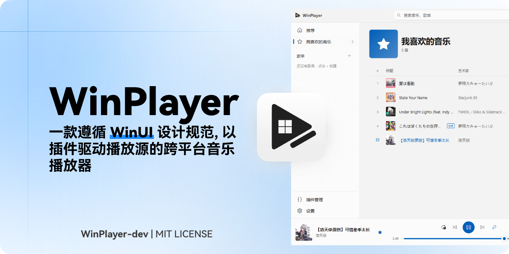
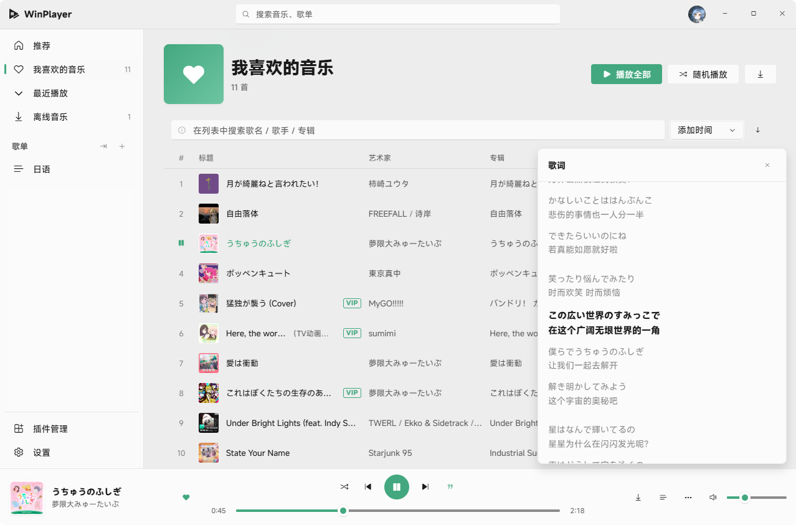

<div align="center">


# WinPlayer

**一款遵循 WinUI 设计规范、基于 Tauri 2 构建、以插件驱动播放源的桌面音乐播放器**

> 这是一坨完全由许愿式编程产出的内容，不过大多数功能均已测试可用


预览图



</div>

---

## ✨ 特性

- 🎨 **WinUI 设计语言** —— 基于 [WinUIonWeb](https://github.com/Furry-Xiyi/WinUIonWeb) 组件库，完整的 Fluent 动画与材质，无边框自定义标题栏，Mica 风格背景，亮/暗主题跟随系统并可手动切换
- 🖌️ **可深度定制的主题系统** —— 主题包（zip）可替换配色令牌、圆角/密度/字体/动效、壁纸与背景氛围层，还能**重写标题栏 / 侧边栏 / 播放条 / 媒体卡片 / 空状态 / 页面骨架**等界面组件；内置基于 MDUI 的 Material Design 3 主题，支持从主题市场安装、即时切换，详见 [docs/THEME-DEVELOPMENT.md](docs/THEME-DEVELOPMENT.md)
- 🧩 **插件化播放源** —— 播放源完全由插件提供，开箱即可通过插件市场、URL 或本地文件安装；插件在 **Web Worker 沙箱**中运行，网络请求经 Rust 后端代理，与主界面隔离
- 🔌 **统一的插件协议** —— 各来源 API 格式千差万别，插件负责将其适配为统一格式；插件可提供搜索、歌曲直链、歌单、推荐、歌词、用户信息等能力
- 🔍 **聚合搜索** —— 顶栏搜索框同时检索所有已启用的插件源，结果按来源分组展示
- 🎧 **完整播放体验** —— 底部播放控制条、播放队列、播放模式（顺序 / 列表循环 / 单曲循环 / 随机）、LRC 歌词滚动显示，架构预留均衡器扩展点
- 🔊 **输出设备选择** —— 原生音频引擎（Symphonia 解码 + rodio 输出），可在设置 → 播放 → 输出设备中切换音频输出设备，或从播放条「更多」菜单快速切换；切换后从当前位置继续播放
- 📚 **本地曲库** —— 我喜欢的音乐、自定义歌单，数据持久化于本地 SQLite
- 🖥️ **系统媒体控件（SMTC）** —— 播放信息与进度同步到 Windows 系统媒体浮出窗 / 锁屏 / 蓝牙设备，可在系统侧直接播放、暂停、切歌（设置 → 系统集成 可关闭）
- 🗂 **插件管理** —— 启用 / 禁用、参数配置、卸载，支持配置多个插件市场源
- 🛍 **主题市场** —— 在插件管理页的「主题」标签中浏览 / 安装 / 更新主题，支持自定义市场源

## 📦 安装 / 构建

### 环境要求

- [Node.js](https://nodejs.org/) ≥ 20.19（推荐 22+）
- [pnpm](https://pnpm.io/) ≥ 10
- [Rust](https://www.rust-lang.org/tools/install)（`rustup`，MSVC 工具链）
- Windows 10 1803+ / Windows 11，需安装 [WebView2](https://developer.microsoft.com/microsoft-edge/webview2/)（Win11 自带）

### 开发

```bash
pnpm install        # 安装前端依赖
pnpm tauri dev      # 启动 Tauri 开发模式
```

### 打包

```bash
pnpm tauri build    # 产出 NSIS / MSI 安装包（src-tauri/target/release/bundle/）
```

## 🧩 插件开发

插件 = `manifest.json` + JavaScript 模块，实现统一接口即可接入任意音乐来源。

```js
// main.js
export default {
  async init(ctx) { /* 可读取 ctx.settings、使用 ctx.request 发起代理请求 */ },

  async search({ keyword, page }) {
    return { songs: [/* UnifiedTrack */], playlists: [/* UnifiedPlaylist */], hasMore: false };
  },

  async getSongUrl({ id }) {
    return { url: 'https://example.com/song.mp3' };
  },

  async getPlaylist({ id }) { /* 返回歌单及曲目 */ },
  async getRecommendations() { /* 返回推荐内容 */ },
  async getLyrics({ id }) { /* 返回 LRC 歌词 */ },
};
```

完整协议见 [docs/PLUGIN-DEVELOPMENT.md](docs/PLUGIN-DEVELOPMENT.md)。

## 🖌 主题开发

主题包 = `theme.json` + 可选的 `theme.css` / 资源 / `.vue` 组件。

```json
{
  "id": "com.example.midnight",
  "name": "Midnight",
  "version": "1.0.0",
  "apiVersion": 1,
  "tokens": { "dark": { "--wp-accent": "#4cc2ff", "--wp-base": "#0d1420" } },
  "density": { "radiusScale": 2, "fontFamily": "\"Noto Sans SC\", sans-serif" },
  "appearance": { "wallpaper": "assets/bg.jpg", "wallpaperBlur": 24 },
  "css": "theme.css",
  "components": { "PlayerBar": "components/PlayerBar.vue" }
}
```

主题组件是普通 Vue 单文件组件，在运行时编译加载，可重写 6 个核心界面组件。
完整字段、可用模块白名单、MDUI 组件用法与市场索引格式见
[docs/THEME-DEVELOPMENT.md](docs/THEME-DEVELOPMENT.md)。

## 🗂 项目结构

```
WinPlayer/
├── src/                    # 前端（Vue 3 + TypeScript）
│   ├── components/         # UI 组件（标题栏、侧边栏、播放器等）
│   ├── views/              # 页面（推荐、搜索、歌单、插件管理…）
│   ├── stores/             # Pinia 状态（播放器、曲库、插件、设置）
│   ├── plugin-runtime/     # 插件沙箱运行时（Web Worker + RPC）
│   ├── services/           # 音频、数据库、插件安装等服务
│   └── types/              # 统一数据类型与插件协议类型
├── src-tauri/              # Rust 后端（窗口、SQLite、HTTP 代理、插件管理）
├── src/themes/             # 内置主题（Material You / MD3），作为主题开发范本
├── plugins/                # 示例插件（开发调试用，不随应用打包）
└── docs/                   # 插件开发文档等
```

## 🙏 致谢

- 桌面框架 [Tauri](https://tauri.app/)、UI 框架 [Vue](https://vuejs.org/)

## 📄 协议

本项目源代码以 [MIT License](LICENSE) 发布。使用本软件时请注意其中集成的第三方组件各自遵循其原始协议。
